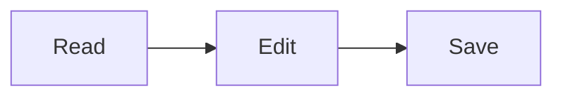

# Markdown flavors and syntax

Markdown comes in dialects. Scrald reads three, called flavors:

- **GFM:** GitHub-flavored Markdown, the most common.
- **Obsidian:** GFM plus Obsidian's wikilinks, callouts, highlights, and comments.
- **Pandoc:** Pandoc's extensions, such as attributes, fenced divs, and definition lists.

## Which flavor a document gets

Scrald uses the first of these:

1. The flavor you chose for the document in the status bar's flavor menu.
2. `scrald-flavor` in the document's front matter.
3. `flavor` in a `.scrald.toml` in the document's folder or above (see [Themes](themes.md)).
4. A guess from the document itself: wikilinks or `==highlights==` suggest Obsidian, and `:::` divs or `{.class}` attributes suggest Pandoc. A document inside an Obsidian vault is Obsidian. With no signs either way, GFM.

In the flavor menu, **Auto** shows the flavor in use and where it came from, such as "Auto: Obsidian (detected)" or "Auto: Pandoc (front matter)". Choosing a flavor there keeps it for the document, and choosing **Auto** again forgets it.

## What each flavor supports

| Feature | GFM | Obsidian | Pandoc |
|---|:-:|:-:|:-:|
| Tables, task lists, strikethrough | ✓ | ✓ | ✓ |
| Footnotes `[^1]` | ✓ | ✓ | ✓ |
| Math `$...$` and `$$...$$` | ✓ | ✓ | ✓ |
| Mermaid diagrams | ✓ | ✓ | ✓ |
| ABC music notation | ✓ | ✓ | ✓ |
| Links written as bare addresses | ✓ | ✓ | |
| GitHub alerts `> [!NOTE]` | ✓ | ✓ | |
| Callouts `> [!tip]-`, foldable | | ✓ | |
| Wikilinks `[[Note]]`, `[[Note\|text]]`, `[[Note#Heading]]` | | ✓ | |
| Image embeds `![[picture.png\|300]]` | | ✓ | |
| Note embeds `![[Other note]]` (as a link) | | ✓ | |
| `==highlight==` | | ✓ | |
| `%%comments%%` (hidden) | | ✓ | |
| `#tags` | | ✓ | |
| Inline footnotes `^[note]` | | | ✓ |
| Attributes `{#id .class}` | | | ✓ |
| Fenced divs `::: warning` | | | ✓ |
| Spans `[text]{.smallcaps}` | | | ✓ |
| Figures with captions | | | ✓ |
| Table captions `Table: ...` | | | ✓ |
| Definition lists | | | ✓ |
| Subscript `~x~` and superscript `^x^` | | | ✓ |
| Smart quotes and dashes | | | ✓ |

In GFM and Obsidian, `~text~` is strikethrough; in Pandoc it's subscript, and `~~text~~` is strikethrough.

## Math

Inline math goes between single dollar signs, and display math between double ones:

```markdown
Euler's identity, $e^{i\pi} + 1 = 0$, and:

$$
\int_0^1 x^2 \, dx = \frac{1}{3}
$$
```

## Diagrams and music

A code block marked `mermaid` is drawn as a [Mermaid](https://mermaid.js.org) diagram:

````markdown

````

A code block marked `abc` is drawn as sheet music from [ABC notation](https://abcnotation.com). It can start with a line of JSON options and a `---` line, as in Obsidian's music plugin.

Diagrams and music are redrawn in a new theme's colors.

## Callouts

```markdown
> [!tip] A title
> The callout's text.

> [!warning]- Folded until clicked
> Hidden at first.
```

`+` after the type starts a callout open but foldable, `-` starts it folded. GitHub's alerts (`> [!NOTE]`, `> [!WARNING]`, and the rest) look the same.

## Image layout (Pandoc)

Attributes on an image place it:

```markdown
{.right width=40%}
```

| Class | Effect |
|---|---|
| `.left`, `.right` | Floats beside the text, which wraps around it. Centered in a narrow window. |
| `.center` | Centered on its own line |
| `.full-bleed` | As wide as the window, past the text's edges |
| `.inline` | In the line of text, like a small icon |

`width` and `height` take pixels or a percentage. An image alone in a paragraph, with alt text, becomes a figure with the alt text as its caption.

A table takes `.center` or `.full-bleed` from its caption: `Table: Ships {.center}`.

## HTML

HTML in a document is shown, but anything that could run code, such as scripts, event handlers, or frames, is removed. A `<details>` block can hold Markdown, including headings, which appear in the contents.
