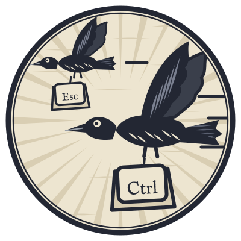

# Keyboard shortcuts

`F1`, `Ctrl+/`, or ? in the status bar shows these in Scrald too.

On a Mac, press `Cmd` where these pages say `Ctrl`, and `Option` for `Alt`. Three are different: Back is `Cmd+[`, Forward is `Cmd+]`, and Redo is `Cmd+Shift+Z`. Scrald's own list and tooltips show the Mac's keys.

## Documents

| Keys | Action |
|---|---|
| `Ctrl+O` | Open a document |
| `Ctrl+N` | Create a new document |
| `Ctrl+S` | Save |
| `Ctrl+P` | Print or save as PDF |
| `Alt+Left` or `Mouse back button` | Back to the previous document |
| `Alt+Right` or `Mouse forward button` | Forward |
| `F1` or `Ctrl+/` | Show these shortcuts |
| `Ctrl+,` | Settings |

## Reading

| Keys | Action |
|---|---|
| `Ctrl+\` | Show or hide the contents |
| `Ctrl+Shift+\` | Show or hide the properties |
| `Ctrl+T` | Choose a theme |
| `Ctrl+=` or `Ctrl+wheel up` | Zoom in |
| `Ctrl+-` or `Ctrl+wheel down` | Zoom out |
| `Ctrl+0` | Reset zoom |

## Find

| Keys | Action |
|---|---|
| `Ctrl+F` | Find in the document |
| `Enter` or `F3` | Next match |
| `Shift+Enter` or `Shift+F3` | Previous match |
| `Esc` | Close the find bar |

## Editing

| Keys | Action |
|---|---|
| `Double-click` | Edit a block |
| `Ctrl+Enter` or `Esc` | Finish editing the block |
| `Ctrl+E` | Switch to raw mode and back |
| `Ctrl+Z` | Undo |
| `Ctrl+Y` or `Ctrl+Shift+Z` | Redo |

## Raw mode

| Keys | Action |
|---|---|
| `Ctrl+F` | Find and replace |
| `F3` or `Ctrl+G` | Next match |
| `Shift+F3` or `Ctrl+Shift+G` | Previous match |
| `Ctrl+Alt+G` | Go to line |
| `Ctrl+/` | Comment lines in or out |

## Properties

While editing a value:

| Keys | Action |
|---|---|
| `Enter` | Keep the change |
| `Ctrl+Enter` | Keep the change to a summary or notes |
| `Esc` | Cancel |

## Themes

| Keys | Action |
|---|---|
| `Up` or `Down` | Preview the previous or next theme |
| `Enter` | Use the theme for this document |
| `Ctrl+Enter` | Save the theme being edited |
| `Esc` | Put the theme back |
